# BloodLink Web

[](https://github.com/Falllll/bloodlink-web/actions/workflows/ci.yml)

Web client for BloodLink, a blood bank management system for Indonesian blood services. This repository holds the Next.js app only: the public landing page, the staff dashboard, and the admin panel.

The API lives in its own repository and this app never calls it from the browser.

- [`Falllll/bloodlink`](https://github.com/Falllll/bloodlink) — Laravel API, headless, `/api/v1`
- [`Falllll/bloodlink-mobile`](https://github.com/Falllll/bloodlink-mobile) — Expo app for donors

## Screenshots

Captured from a seeded local stack. Reproduce them with one command — see [Screenshots (capturing)](#screenshots-capturing).

### Landing page

The public page: what the system is for, an eligibility self-check a visitor can answer without registering, and a chat launcher that opens a conversation with a real facility.

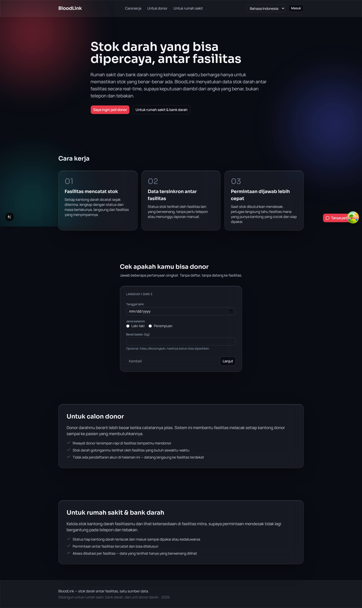

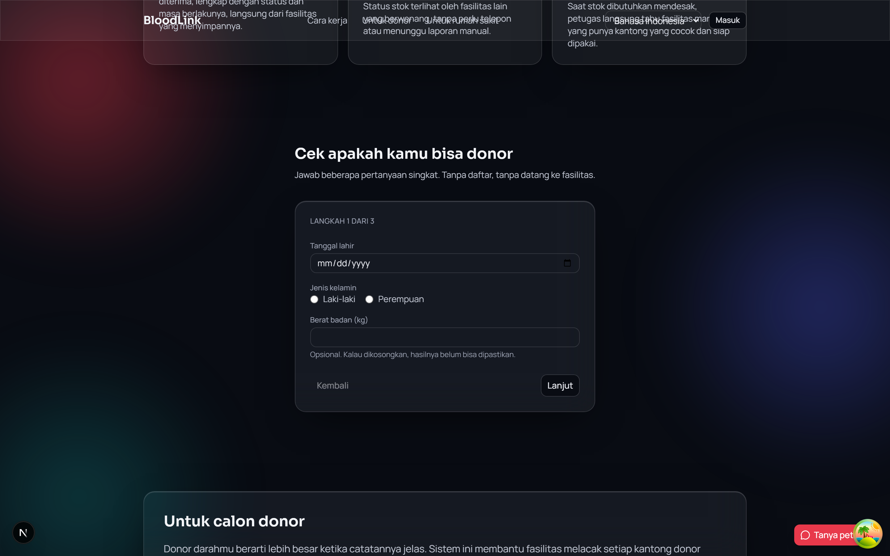

### Staff dashboard

| Dashboard | Facility map |
|---|---|
| 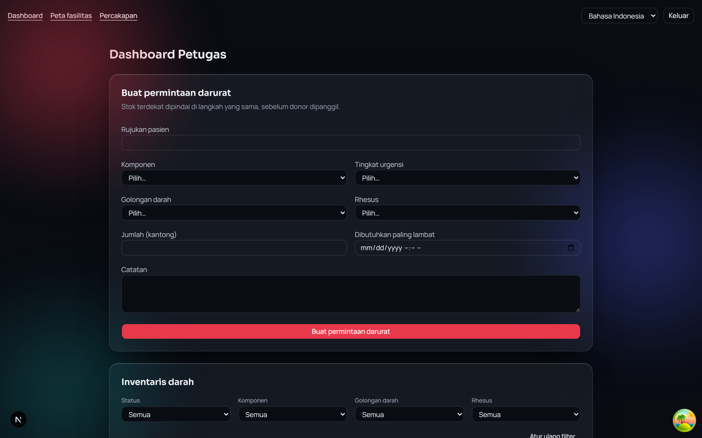 | 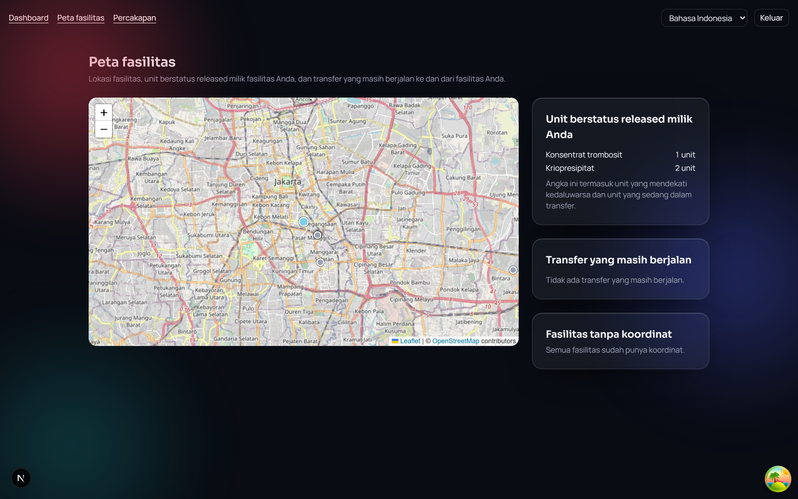 |

The map draws facilities and their stock from PostGIS coordinates. Tiles come from the public OpenStreetMap tile server, so the OSM attribution is not decoration — it is the licence.

### Admin panel

| Donors | Facilities |
|---|---|
| 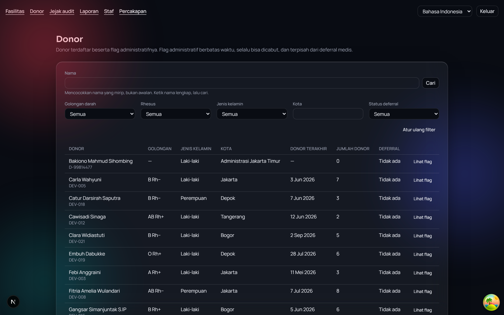 | 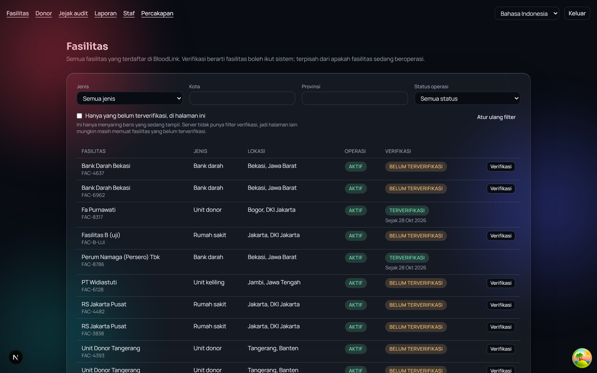 |

| Reports | Audit trail |
|---|---|
| 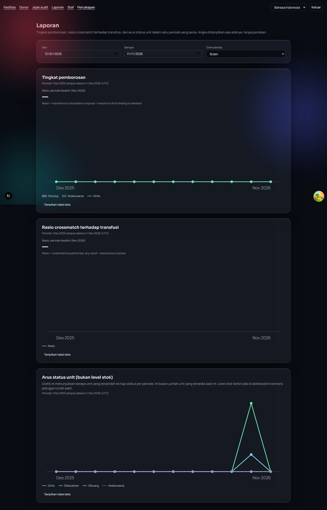 | 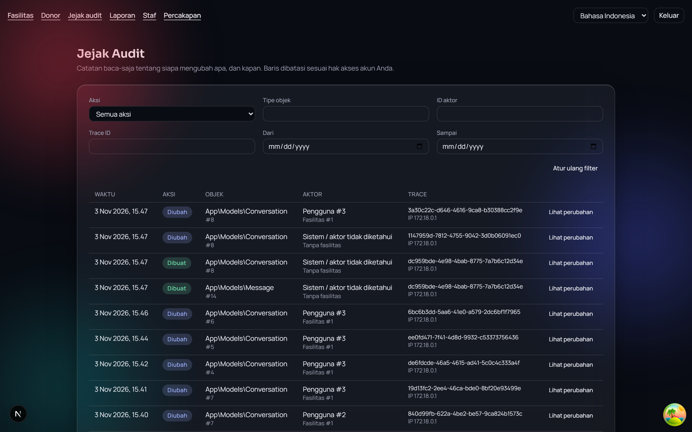 |

<details>
<summary>Remaining screens</summary>

| Sign in | Conversations |
|---|---|
| 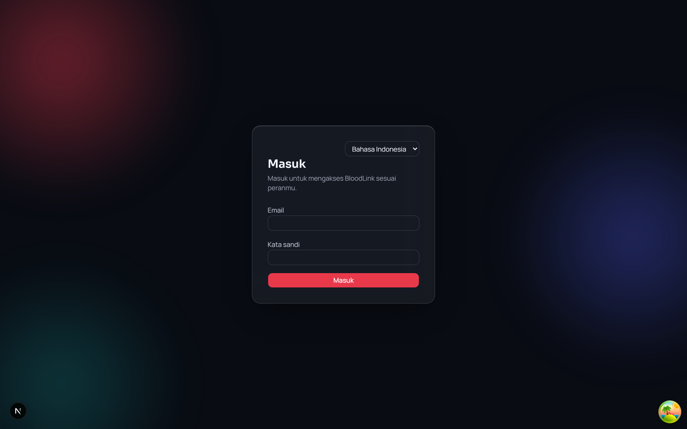 | 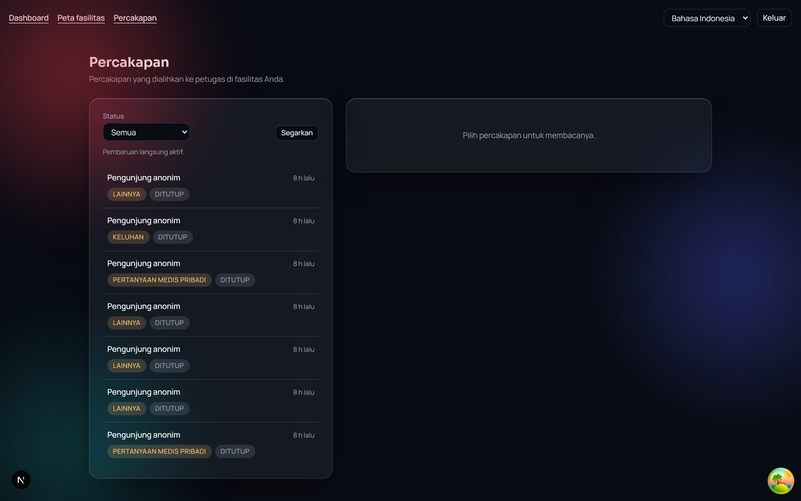 |

| Admin home | Staff |
|---|---|
| 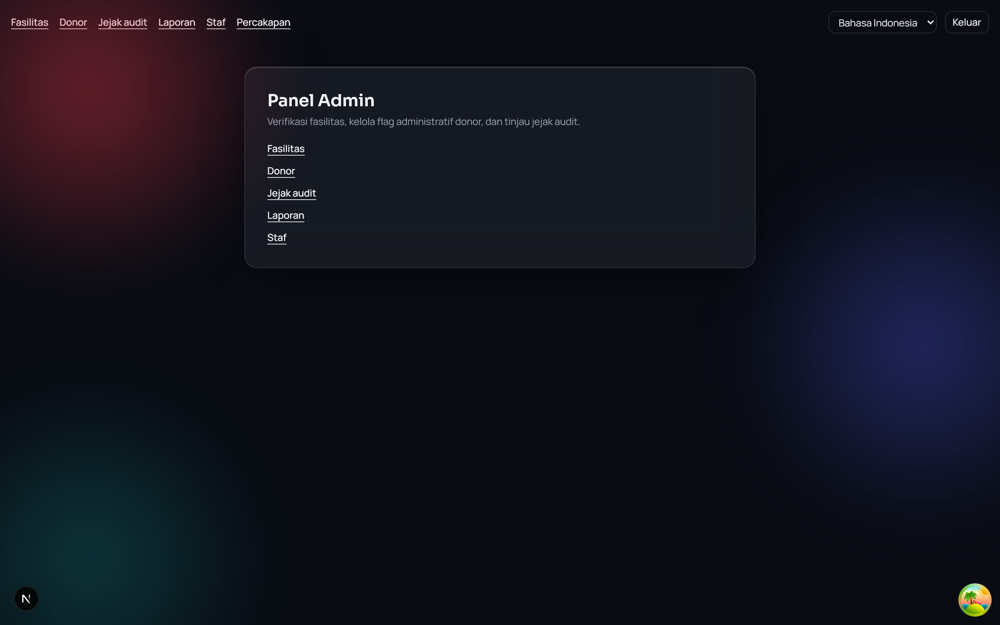 | 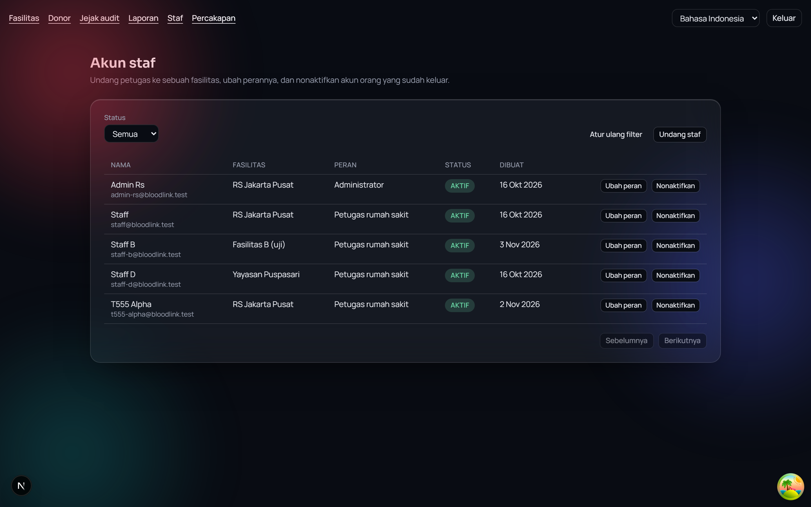 |

</details>

## Stack

| | |
|---|---|
| Framework | Next.js 16.4.2, App Router |
| UI | React 19.2, TypeScript, Tailwind CSS 4, shadcn/ui |
| Data fetching | TanStack Query 5 |
| i18n | next-intl 4.14 — five locales, no hardcoded strings |
| Maps | Leaflet 1.9 + react-leaflet 5, OpenStreetMap tiles |
| Realtime | laravel-echo + pusher-js, against self-hosted Laravel Reverb |
| Runtime | Node.js ≥ 20.9.0 (`.nvmrc` pins 22), npm — not pnpm or yarn |

Every dependency is free and open source. There is no paid service in the pipeline, and the WebSocket server is self-hosted Reverb rather than Pusher Cloud.

## How it is wired

Four decisions explain most of the code. They are settled; `AGENTS.md` holds the full list.

**The browser never talks to Laravel.** Every call goes through a Next route handler at `/bff/*` (`src/app/bff/[...path]/route.ts`), which forwards to the API and attaches the `Authorization` header server-side. `API_BASE_URL` deliberately has no `NEXT_PUBLIC_` prefix — that is the single fact the whole BFF pattern rests on. Give it that prefix and the indirection becomes theatre.

**The session token is never in `localStorage`.** It lives in an httpOnly cookie set by the route handler (`src/lib/auth/session.ts`). JavaScript in the page cannot read it, so an XSS bug cannot walk off with the session. The mobile app does the opposite — `expo-secure-store` and direct API calls — on purpose: a device keystore and a browser are not the same threat model.

**There is no refresh token.** The API issues plain Sanctum tokens and has no refresh endpoint. When a token dies, the cookie is cleared and the user lands on `/login`. Anything that looks like silent re-authentication would be inventing a backend feature that does not exist.

**Clients branch on `error.code`, never on `error.message`.** Codes are a contract; messages are free to change or be translated. This matters more than it looks: the API refuses requests for medical safety reasons — a unit that has not cleared lab testing, an incompatible blood group, a donor who has not waited long enough — and the UI has to tell a medical refusal from a broken server without pattern-matching on prose. The `ErrorCode` union in `src/lib/api/types.ts` must stay in step with `App\Shared\Errors\ErrorCode` in the API repo.

Two smaller rules that are easy to break by accident:

- **`Idempotency-Key` is generated by the caller**, once per user action (`newIdempotencyKey()`), and reused on every retry of that action. Generating it inside `apiFetch` or in the proxy would mint a fresh key per attempt and destroy the protection exactly when it is needed.
- **Lists paginate by cursor.** The API sends no totals, so the UI must never render "page 3 of 47".

## Pages

| Route | Menu label | What it shows |
|---|---|---|
| `/` | — | Landing: hero, how it works, eligibility self-check, donor and facility sections, chat launcher |
| `/login` | Masuk | Email and password, locale switcher |
| `/dashboard` | Dashboard | Staff overview for the signed-in facility |
| `/dashboard/map` | Peta fasilitas | Facilities and stock on a Leaflet map |
| `/dashboard/conversations` | Percakapan | Visitor conversations escalated to staff — only when the role carries `chat.view` |
| `/admin` | Panel Admin | Admin landing |
| `/admin/facilities` | Fasilitas | Facility registry |
| `/admin/donors` | Donor | Donor registry |
| `/admin/audit-logs` | Jejak audit | Append-only audit trail, cursor-paginated |
| `/admin/reports` | Laporan | Wastage rate, crossmatch-to-transfusion ratio, unit status flow |
| `/admin/staff` | Staf | Staff accounts, roles, facility assignment |
| `/dev` | — | Design tokens and base components. A workbench, not a product page. |

The dashboard nav renders the admin link only for roles that may use it, and the conversations link only when the role carries `chat.view`; both are read server-side from the session, not from a client-side role guess.

Route handlers under `/bff/*`, `/api/session/*` and `/broadcasting/auth` are plumbing — they return no UI.

## Getting started

The API has to be running first. This app is a client; on its own it renders empty states and sign-in failures. Follow the [API repository's getting started](https://github.com/Falllll/bloodlink#getting-started), then confirm it answers:

```bash
curl localhost:8000/api/v1/ping      # {"pong":true}
```

Then:

```bash
git clone https://github.com/Falllll/bloodlink-web && cd bloodlink-web
nvm use                 # or any Node >= 20.9.0
npm ci
cp .env.example .env.local
npm run dev             # http://localhost:3000
```

`.env.local` values:

| Variable | Required | Notes |
|---|---|---|
| `API_BASE_URL` | yes | Where Laravel is, e.g. `http://localhost:8000/api/v1`. **Never** prefix with `NEXT_PUBLIC_`. |
| `NEXT_PUBLIC_REVERB_APP_KEY` | for realtime | Match `REVERB_APP_KEY` in the API's `.env`. This key is public by design — it is the client key; the secret stays in the backend. |
| `NEXT_PUBLIC_REVERB_HOST` | for realtime | `localhost` locally |
| `NEXT_PUBLIC_REVERB_PORT` | for realtime | `8080` locally |
| `NEXT_PUBLIC_REVERB_SCHEME` | for realtime | `http` locally, `https` behind TLS |
| `CHAT_FACILITY_ID` | no | `public_id` (UUID) of the facility the landing-page chat opens against. Leave it empty and the chat launcher is simply not rendered — useful, and the reason an empty value is not an error. |

Sign-in needs a seeded staff account. The API's seeder creates the facilities, donors and units; the credentials for the test accounts are kept out of this repository on purpose.

## Development

```bash
npm run dev            # dev server
npm run build          # production build
npm run lint           # eslint
npm run i18n:check     # every locale has every key, and no key is unused
```

**Type checking needs a codegen step first.** Next 16 generates the `LayoutProps<'/'>` and `PageProps` globals from the route tree, so on a fresh clone `tsc` fails with `Cannot find name 'LayoutProps'` until those types exist:

```bash
npx next typegen        # writes .next/types/*
npx tsc --noEmit
```

`next dev` and `next build` generate them too, so this only bites when you typecheck before ever running either. CI runs `next typegen` first for the same reason.

There is no `typecheck` npm script; the two commands above are the whole of it.

## Internationalisation

Five locales live in `messages/`: `id`, `en`, `de`, `ja`, `zh`. Indonesian is the source of truth for wording.

No string is hardcoded in a component. `npm run i18n:check` is what keeps that true, and it runs in CI, so a missing translation key fails the build rather than reaching a page as a raw `shell.navDonors`.

## Screenshots (capturing)

`scripts/capture-screenshots.mjs` drives headless Chromium over the real app and writes `docs/screenshots/*.png` at 1440x900 @2x. It starts nothing: bring the stack up first.

```bash
npm i -D playwright && npx playwright install chromium   # once
# API on :8000 (seeded) and `npm run dev` on :3000, both already running
BL_EMAIL='<staff email>'       BL_PASSWORD='<password>' \
BL_ADMIN_EMAIL='<admin email>' BL_ADMIN_PASSWORD='<password>' \
  node scripts/capture-screenshots.mjs
```

Two accounts, not one, because the app routes by role: a staff account sent to `/admin` lands on `/dashboard`, and an admin account sent to `/dashboard` lands on `/admin`. Neither can photograph the whole app alone — and a script that followed those redirects quietly would file a picture of `/admin` under the name `dashboard.png`.

So it refuses two things, and exits non-zero on either: a page that redirected anywhere other than where it was sent, and a page that rendered but has no data rows. That is the whole point of it. A README screenshot whose job is to show data is worse than no screenshot at all when it is wrong, because it looks finished and proves nothing. `EMPTY` means re-seed the API; `REDIRECTED` means the shot was asked for under the wrong account.

With no credentials it captures the public pages and records the rest as missing. `docs/screenshots/MANIFEST.txt` records what was taken, when, and at what size.

## Quality gates

CI runs, in order, on every push and pull request:

```
npm ci  →  npm audit (critical, prod deps)  →  next typegen  →  tsc --noEmit
        →  eslint  →  i18n:check  →  next build
```

A `gitleaks` configuration lives in `.gitleaks.toml`. Enable the local pre-commit hook once per clone:

```bash
git config core.hooksPath .githooks
```

## Caveats

- **Map tiles come from the public OSM tile server.** That is fine for a portfolio and not fine for production traffic; the OSM tile usage policy is explicit about it. Swap the tile provider before this is put in front of real users.
- **This is a portfolio project.** It follows WHO guidance where the API encodes medical rules, and the API repository documents that chapter by chapter — but it has not been reviewed by a medical professional and is not ready for a real blood service without that review and adaptation to local regulation.
